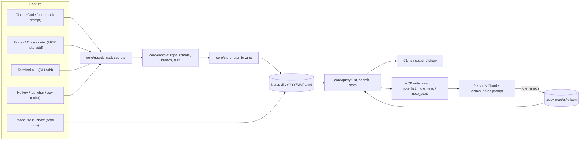

# PROJECT_SPEC.md
**Last updated**: 2026-11-14
**Version**: 0.3 (round 3: one press + Claude detail, `BRAINSTORMING_LOG_oneclick-enrich.md`)

> **Scope of this document**: *How* to build it safely — architecture, agent config, constraints, risk areas, task state, and accumulated learnings.
> Product intent (personas, user stories, FR/NFR, success metrics) lives in `PRD.md`.
> If Critical Constraints here conflict with Out of Scope in `PRD.md`, resolve before Stage 2.

---

## Project Identity

- **Name**: easy-note-mcp (MCP server id `easy-note`, CLI `easy-note`)
- **Repo**: `thunderkds/easy-note-mcp` (to be created; not created by this plan)
- **Primary tech**: Python ≥ 3.11, official MCP Python SDK (FastMCP), PyYAML (front matter), `uv`
- **Type**: MCP server (stdio default, streamable HTTP opt-in on `127.0.0.1:8769`) + CLI
- **Deployment target**: the owner's machine, native install (`uv tool install`), no Docker (DDR 0001)
- **Key stakeholders**: thunderkds (owner)
- **Family place**: plug-in. Usable with or without the kernel (easy-kit). Read by easy-personal through the file format only (DDR 0002).

---

## Architecture Summary

Two layers in one package. **Core** owns the file format, the store (a folder of files), context capture,
the secret guard and queries. **Surfaces** — CLI and MCP — call only the core, so both give the same results.
There is no database: the notes folder is the single source of truth.

```
src/easy_note/
  core/format.py     parse / render a note (front matter + body), version check (easy-note: 1)
  core/store.py      resolve dir, new ID, atomic write, list files, trash/restore
  core/context.py    cwd resolution (arg → roots → process cwd), git repo/remote/branch, task patterns
  core/guard.py      declared secret patterns: mask on write and on read (never refuse, D21)
  core/query.py      list / search / stats over parsed notes; bounded results
  surfaces/cli.py    `easy-note` commands (FR-013)
  surfaces/mcp.py    7 tools + 1 prompt (FR-012, D37), stdio + streamable-http
  surfaces/hook.py   Claude Code UserPromptSubmit capture (FR-018); stdlib-only pass path
  surfaces/quick.py  one-line native input box (FR-022)
  surfaces/install.py `install|uninstall claude|launcher|tray` (FR-019, FR-026, FR-033, DDR 0003)
  core/ai.py         AI detail files: write with caps + mask, hash staleness, pending list (FR-029–FR-032, DDR 0004)
  surfaces/tray.py   optional system tray (FR-033), extra `[tray]`
  surfaces/prompts.py fixed `enrich_notes` prompt text (FR-031)
  console scripts:   `easy-note`, `n` (= `easy-note add`)
tests/fixtures/      synthetic notes dirs incl. planted secrets, bad front matter, two-machine clash
docs/NOTE_FORMAT.md  the public file contract (DDR 0002)
```

Flow of `note_add("retry bug only on Firefox #flaky")` from Claude Code in `~/ws/easy-ui-mcp` on branch `fix/t120-firefox`:
guard (pass) → context (cwd from roots → repo `easy-ui-mcp`, remote `thunderkds/easy-ui-mcp`, branch, task `T120`) →
tags `["flaky"]` → ID `20261114-164713-a1b2` → atomic write `~/easy-notes/2026/11/20261114-164713-a1b2.md` → returns id + path.

Capture paths (round 2), all into the same core `store.add()`:

| Situation | Gesture | Path | Model call? | Context source |
|---|---|---|---|---|
| Claude Code chat | `/note retry bug on firefox` | hook → block + `✓ noted …` | No | hook input `cwd` |
| Codex / Cursor chat | `note: retry bug on firefox` | model → `note_add` | Yes (1 turn) | `cwd` arg → roots → process cwd |
| Terminal | `n retry bug on firefox` | CLI | No | shell cwd |
| Editor / desktop | hotkey or dock icon → one-line box | `easy-note quick [--cwd]` | No | `--cwd` from editor snippet, else last context < 2 h |
| System tray (`easy-note tray`) | click icon → "New note" | tray runs `quick` | No | last context |
| Phone / other device | save a file into `inbox/` via the sync app | read-only inbox | No | none |

Detail later (round 3): person runs `/mcp__easy-note__enrich_notes` → their Claude (one subagent) → `note_pending_enrich` → reads note + transcript (if `session` and file exist) → `note_enrich` → `.easy-note/ai/<id>.json`. easy-note runs no model; note files are never touched.

---

Main flow (capture → store → read → later detail):



---

## Readiness

- **Requirements**: PRD.md
- **Direction**: BRAINSTORMING_LOG.md (Option B; rounds 2–3: BRAINSTORMING_LOG_capture.md, BRAINSTORMING_LOG_oneclick-enrich.md)
- **Codebase map**: none — blank scaffold (code starts with HUN-252)
- **Tech stack**: Python ≥ 3.11, official MCP Python SDK (FastMCP), PyYAML, uv; storage = plain Markdown files; hosting = the owner's machine, native install, no Docker
- **Main flow**: PROJECT_SPEC.md (Mermaid flowchart in Architecture Summary)
- **Approved by**: 

---

## Glossary

- **Note** — one Markdown file written in the format `easy-note: 1`: front matter + body. Never an easy-memory note (that is a saved agent turn).
- **Notes dir** — the folder the person picked; the only store.
- **Context** — the `repo`, `remote`, `branch`, `task` fields captured at add time.
- **Guard** — the declared secret patterns; mask on write and on read, never refuse (D21).
- **Trash** — `<notes dir>/.easy-note/trash/`; restorable.
- **Skipped** — a file in the notes dir the parser cannot read; counted and reported, never changed.

---

## Critical Constraints

- Writes only inside the notes dir and `~/.config/easy-note/config.toml` (DDR 0001), plus exactly one hook entry in user-level `settings.json` and `commands/note.md` in the Claude Code config dir (`$CLAUDE_CONFIG_DIR` when set, else `~/.claude`), only via person-run `install claude` with diff + backup (DDR 0003); `~/.local/share/applications/easy-note.desktop` only via `install launcher`; `~/.config/autostart/easy-note-tray.desktop` only via `install tray`. Never in any code repo, never project-scope config, never Codex/Cursor config, never in another plug-in's folder.
- No capture path may drop typed text: no setup refusal, no secret refusal (mask instead).
- Inbox files are never written, renamed or normalized.
- The hook pass path imports only the stdlib and never fails a prompt.
- No model call inside easy-note, ever. AI detail is written only by `note_enrich` into `.easy-note/ai/`, capped, masked, labelled; it never changes a note file and never feeds counts (DDR 0004).
- Git is read-only: only `git rev-parse`, `git branch --show-current`, `git remote get-url origin`, with a 2 s timeout. No commit, fetch, or push.
- No traffic leaves the machine; HTTP binds `127.0.0.1` only, never `0.0.0.0`.
- No MCP tool may edit, delete, restore, move a note or change config (FR-012). Tool surface is frozen once approved; new tools need owner approval.
- No secret in any written note, response or log; logs never contain note text (FR-014, NFR-002).
- Never store a filesystem path or cwd in a note (FR-004).
- Deterministic: no LLM; same files + query → same output.
- The file format is a public contract: a breaking change needs `easy-note: 2`, a DDR and a reader for v1 files.
- Sibling repos are conventions-only references; never import or vendor their code (the guard's patterns are re-declared here).
- Works with no kernel and no other plug-in installed; the kernel never depends on easy-note.

---

## Known Risk Areas

| Area | Risk Level | Reason | Files |
|------|-----------|--------|-------|
| Secret leakage | High | Notes are free text, may be git-synced | `core/guard.py`, all surfaces |
| Context capture | Med | Clients differ in cwd/roots; a wrong repo tag is silent | `core/context.py` |
| File writes | Med | Must never overwrite or corrupt a person's file; sync tools may race | `core/store.py` |
| Format parsing | Med | Hand-edited files; Obsidian adds its own keys | `core/format.py` |
| Prompt hook | Med | Runs on every Claude Code prompt; a bug or slow path hurts every session | `surfaces/hook.py` |
| Tray process | Low | Resident process; GNOME needs AppIndicator | `surfaces/tray.py` |
| Settings install | Med | Writes the person's Claude Code settings | `surfaces/install.py` |
| AI detail | Med | Model text in the notes dir; may be wrong or quote a transcript | `core/ai.py`, `surfaces/prompts.py` |
| Search speed | Low | Scan of all files per query | `core/query.py` |

---

## Sub-Agent Team

Base team only (no `craft-agent` role needed).

| Agent | Role | CLI Spawn Command |
|---|---|---|
| Common-Infrastructure-Agent | Repo skeleton, `uv` project, CI, fixtures layout | `Agent({ subagent_type: "common-infrastructure", prompt: "Task T002 …" })` |
| Backend-Implementer | Core + CLI + MCP | `Agent({ subagent_type: "backend-developer", prompt: "Task T00x …" })` |
| QA-Automation-Agent | Spike, leak suite, perf check, Acceptance Criteria evidence | `Agent({ subagent_type: "qa-expert", prompt: "Task T00x …" })` |

No Frontend-Implementer in v1: the UI is the one-line OS box and a tray menu (pystray), both Backend work.

---

## CLI Model Table

| CLI | Run command | C0 | C1 | C2 | C3 |
|---|---|---|---|---|---|
| claude | `claude` | haiku | sonnet | sonnet or opus | opus |

---

## MCP Tool Contract (v1, frozen after approval)

| Tool | Args | Returns | Writes? |
|---|---|---|---|
| `note_add` | `text` (req), `tags[]`, `task`, `cwd` | `id`, `path`, `repo`, `branch`, `task`, `tags` | Yes — one new file only |
| `note_search` | `query` (req), `repo`, `task`, `tag`, `source`, `since`, `until`, `limit≤50` | items (FR-016), `total`, `truncated` | No |
| `note_list` | same filters, `day`, `limit≤50` | items, `total`, `truncated` | No |
| `note_read` | `id` (req) | full note, secrets masked | No |
| `note_stats` | filters optional | counts (FR-015), `skipped`, `enriched` | No |
| `note_pending_enrich` | `limit≤20` | notes needing AI detail (FR-029) | No |
| `note_enrich` | `id`, `title`, `kind`, `summary`, `tags_suggested`, `model` | `id`, `based_on` | Yes — one AI file only |
| prompt `enrich_notes` | — | fixed instructions (FR-031) | — |

Tool descriptions must say: "Call `note_add` only when the person asks to note something."

Client config snippets (README, T009): Claude Code `claude mcp add easy-note -- easy-note serve` (user scope by the person's choice); Codex `~/.codex/config.toml` `[mcp_servers.easy-note]`; Cursor `~/.cursor/mcp.json`. easy-note never writes these files (DDR 0001).

---

## Tasks

| ID | Title | Status | Assigned Agent | Complexity | Risk | Priority |
|----|-------|--------|---------------|-----------|------|----------|
| T001 | Spike: how Claude Code, Codex, Cursor start stdio servers (cwd, MCP roots, client name) | Todo | QA-Automation-Agent | C1 | Med | P0 |
| T002 | Repo skeleton: kit artifacts, `uv` project, `src/easy_note/{core,surfaces}`, CLI + MCP entry points over one core | Todo | Common-Infrastructure-Agent | C1 | Low | P0 |
| T003 | Note format + store: parse/render, ID, atomic write, clash suffix, trash/restore, skipped files, `docs/NOTE_FORMAT.md` | Todo | Backend-Implementer | C2 | Med | P0 |
| T004 | Context capture: cwd order, main-worktree repo name, remote sanitizing, task patterns | Todo | Backend-Implementer | C1 | Med | P0 |
| T005 | Secret guard + masking + leak test suite | Todo | Backend-Implementer + QA-Automation-Agent | C1 | High | P0 |
| T006 | Query engine: list, search, stats, bounded results | Todo | Backend-Implementer | C1 | Low | P1 |
| T007 | CLI commands (FR-013) | Todo | Backend-Implementer | C1 | Low | P1 |
| T008 | MCP surface: 5 tools, stdio + streamable-http on 127.0.0.1:8769, no-write test for 4 read tools | Todo | Backend-Implementer | C1 | Med | P1 |
| T009 | README, RUNBOOK, client config snippets, install guide | Todo | Backend-Implementer | C0 | Low | P1 |
| T010 | Perf check: 10,000-note fixture; confirm or reset NFR-004, NFR-009, NFR-010 | Todo | QA-Automation-Agent | C0 | Low | P2 |
| T011 | Claude Code capture: `hook-prompt`, `install`/`uninstall claude`, `note.md` fallback | Todo | Backend-Implementer | C2 | Med | P1 |
| T012 | One press / one click: `easy-note quick` (< 300 ms, last context), `hotkey` helper, `install launcher`, editor snippets | Todo | Backend-Implementer | C1 | Low | P1 |
| T013 | Read-only `inbox/` notes | Todo | Backend-Implementer | C1 | Med | P1 |
| T014 | Claude detail: `session`/`commit` fields, AI files, 2 MCP tools, `enrich_notes` prompt, CLI `ai rm` / `--accept-ai` | Todo | Backend-Implementer + QA-Automation-Agent | C2 | Med | P1 |
| T015 | System tray icon `easy-note tray` + `install/uninstall tray` (XDG autostart) | Todo | Backend-Implementer | C2 | Low | P2 |

Dependencies: T001 → T004, T011; T002 → all; T003 → T004, T005, T006, T013; T006 → T007, T008; T005 → T007, T008, T011; T007 → T011, T012. T009 and T010 last.
T003, T011 → T014. Vital slice for "easy" (ship first): T011 + T007's `n`/zero-setup + T005 masking. Then T012 (one press), T013, T014.
Track: every task is extended track (new repo, more than one agent).
Board IDs (Linear project `easy-note-mcp`, synced 2026-11-14; status lives on the board / `PROJECT_KANBAN.md`): T001=HUN-251 · T002=HUN-252 · T003=HUN-253 · T004=HUN-254 · T005=HUN-255 · T006=HUN-256 · T007=HUN-257 · T008=HUN-258 · T009=HUN-264 · T010=HUN-265 · T011=HUN-259 · T012=HUN-260 · T013=HUN-261 · T014=HUN-262 · T015=HUN-263.

Follow-ups on other boards (not in this KANBAN — Hard-Stop Gate 4):
- **F1 (easy-personal board)**: a read-only `notes` source: counts per repo/task + file links, front matter only; its own DDR beside its DDR 0002.
- **F2 (easy-kit board)**: add easy-note to `companion-setup`'s list of optional companions.
- **F3 (easy-personal board, optional since round 3c)**: a "New note" item in its planned Tauri tray (`BRAINSTORMING_LOG_WATCH.md` D1) that runs `easy-note quick` when it is on PATH and is hidden otherwise; easy-note never depends on it.

---

## Memory / Insights

| Date | Insight | Source Task |
|------|---------|------------|
| 2026-11-14 | "Note" means two things in the family: easy-memory's saved agent turn and easy-note's person note. Keep the names apart in docs (`memory note` vs `note`). | brainstorm |
| 2026-11-14 | easy-personal's store is metadata only (NFR-002); text storage needed DDR 0003 and stays capped and non-editable, so notes cannot live there. | brainstorm |
| 2026-11-14 | Ports in use: 8765 easy-ui, 8766 easy-verifier, 8767 easy-context, 8768 easy-personal → easy-note takes 8769. | brainstorm |
| 2026-11-14 | Capture ease is decided by the most used path: in Claude Code a note through MCP costs a model turn and pollutes the task; a `UserPromptSubmit` hook that blocks the prompt costs none (`BRAINSTORMING_LOG_capture.md`). | capture brainstorm |
| 2026-11-14 | Owner's desktop is Linux/GNOME and easy-personal already plans a Tauri tray; one tray per person, so easy-note's tray entry lives there (F3). | round 3 |
| 2026-11-14 | Kit task branches name the task (`fix/t120-x`, `easy-kit/docs/claude-md/tracks.md:329`), so task IDs can come from the branch. | grill |
